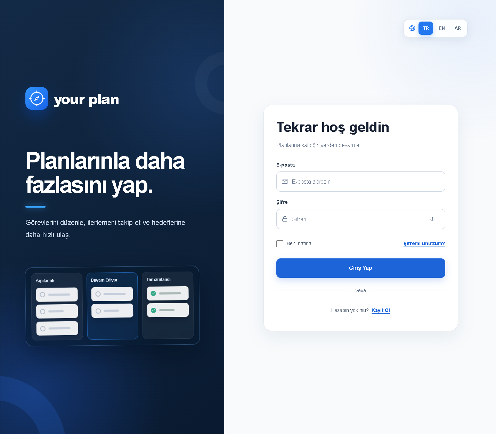
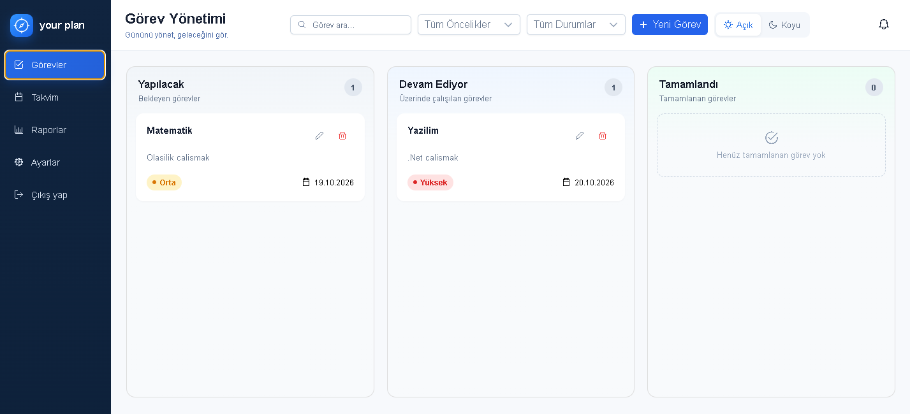
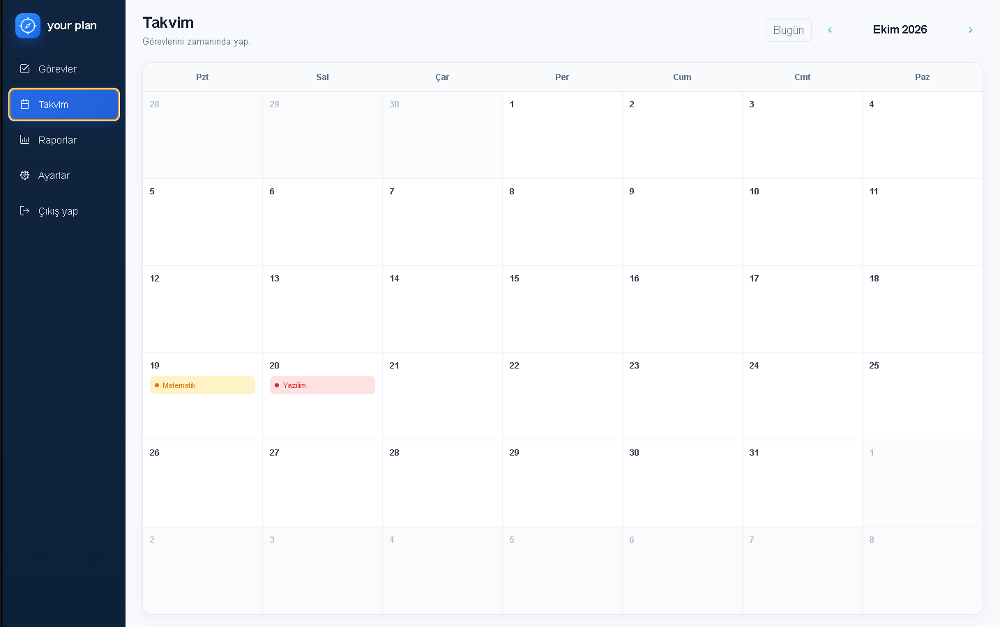
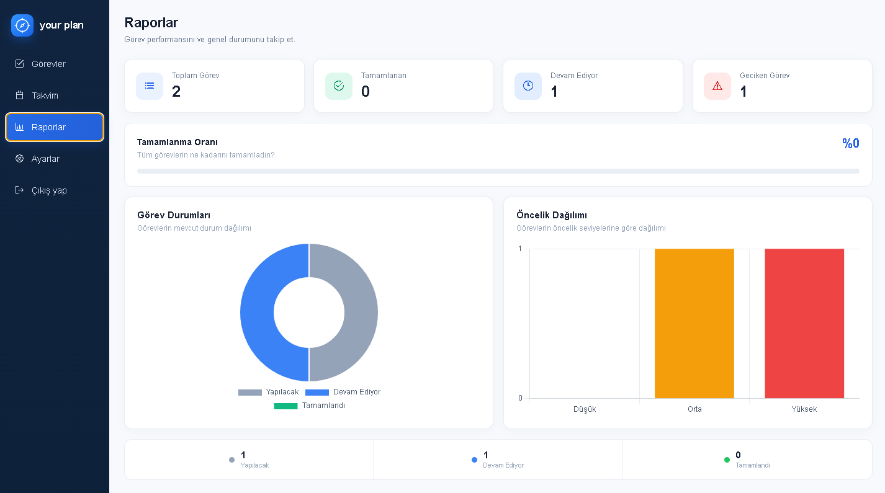
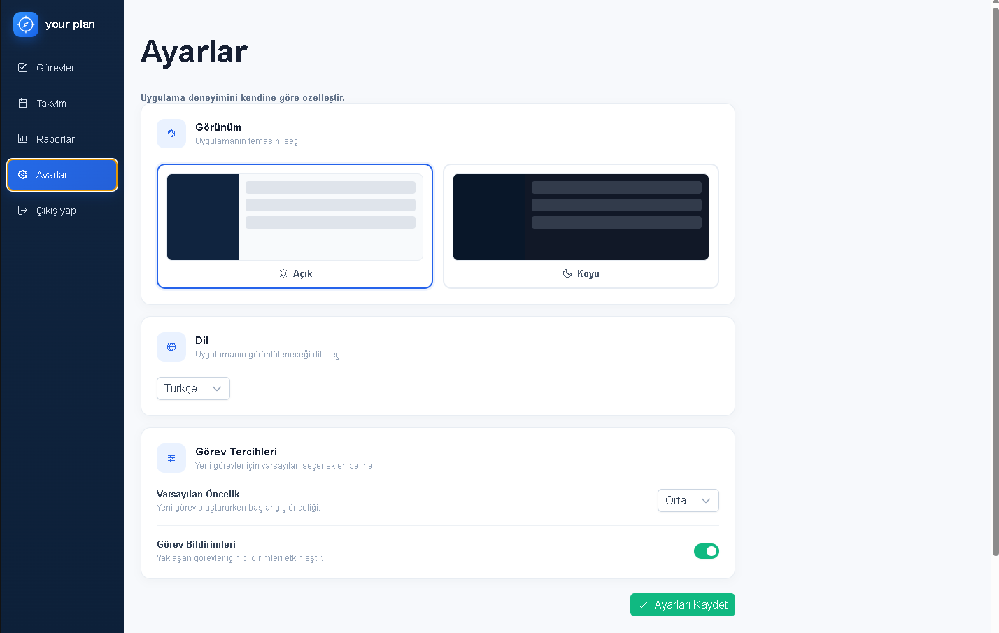

# Your Plan

[](https://github.com/bessar2004/todo_list/actions/workflows/ci.yml)
[](LICENSE)

**Your Plan**, görevlerini Kanban panosunda düzenlemeni, takvimde görmeni ve raporlarla ilerlemeni takip etmeni sağlayan kişisel bir görev yönetim uygulamasıdır. Her kullanıcı yalnızca kendi görevlerini görür. Arayüz Türkçe, İngilizce ve Arapça olarak kullanılabilir.



## Özellikler

- **Kanban panosu:** Görevleri sürükle-bırak ile sütunlar arasında taşı. Durum değişikliği veritabanına kaydedilir.
- **Görev yönetimi:** Başlık, açıklama, öncelik (düşük / orta / yüksek) ve son tarih ile görev ekle, düzenle, sil. Görev tamamlanınca tamamlanma zamanı kaydedilir.
- **Arama ve filtre:** Görevleri metne, duruma ve önceliğe göre filtrele.
- **Takvim:** Son tarihi olan görevleri takvim üzerinde gör.
- **Raporlar:** Durum ve öncelik dağılımını grafiklerle incele.
- **Hesap sistemi:** Kayıt, giriş, "şifremi unuttum" (e-posta ile sıfırlama, SMTP ayarı gerektirir), profil adını güncelleme ve şifre değiştirme.
- **Kullanıcıya özel veri:** Görevler hesaba bağlıdır, başka bir kullanıcının görevine erişilemez.
- **Çoklu dil ve tema:** Türkçe, İngilizce, Arapça; açık ve koyu tema.
- **Güvenlik:** JWT ile kimlik doğrulama, şifre değişince eski oturumların geçersiz olması, hesap kilitleme, giriş/kayıt/şifre işlemlerinde hız sınırı, API yanıtlarında güvenlik başlıkları (CSP, X-Frame-Options vb.) ve production'da HSTS.

## Ekran görüntüleri

**Görevler (Kanban panosu):** Görevler Yapılacak, Devam Ediyor ve Tamamlandı sütunlarında; arama, öncelik/durum filtresi ve tema seçimi üstte.



**Takvim:** Son tarihi olan görevler günlerin üzerinde öncelik rengiyle görünür.



**Raporlar:** Toplam, tamamlanan, devam eden ve geciken görevler; durum ve öncelik grafikleri.



**Ayarlar:** Açık/koyu tema, dil seçimi ve görev tercihleri.



## Kullanılan teknolojiler

| Katman  | Teknoloji                                                  |
| ------- | ---------------------------------------------------------- |
| Arayüz  | Angular 21, PrimeNG, Chart.js, Angular CDK (sürükle-bırak) |
| API     | ASP.NET Core 10 (Web API), Identity, JWT, Swagger          |
| Veri    | Entity Framework Core, SQL Server                          |
| E-posta | MailKit (SMTP)                                             |
| Test    | xUnit (API), Vitest (arayüz)                               |
| CI      | GitHub Actions                                             |

## Hızlı başlangıç

### Gereksinimler

- .NET SDK 10
- Node.js 22 ve npm
- SQL Server LocalDB (Windows)
- EF Core komut aracı (`dotnet ef`)

### Kurulum

Komutları proje klasöründe PowerShell ile çalıştır:

```powershell
if (-not (Test-Path appsettings.Development.json)) {
    Copy-Item appsettings.Development.example.json appsettings.Development.json
}
$jwtKey = [Convert]::ToBase64String([Security.Cryptography.RandomNumberGenerator]::GetBytes(32))
dotnet user-secrets set 'Jwt:SigningKey' $jwtKey --project TodoApp.Api.csproj
dotnet ef database update --project TodoApp.Api.csproj
npm.cmd ci --prefix todo-app-client
```

`appsettings.Development.json` ve kullanıcı sırları Git'e eklenmez. JWT anahtarını README'ye veya kaynak koda yazma. Komut, var olan yerel ayar dosyanın üzerine yazmaz.

### Çalıştırma

İki ayrı terminal aç:

```powershell
dotnet run --project TodoApp.Api.csproj --launch-profile http
```

```powershell
Set-Location todo-app-client
npm.cmd start
```

- Uygulama: http://localhost:4200/login
- API / Swagger: http://localhost:5072/swagger

Giriş ekranından **Kayıt Ol** ile bir hesap oluşturup kullanmaya başlayabilirsin. Şifre en az 15 karakter olmalıdır.

## Proje yapısı

```text
.
├── Controllers/            API uç noktaları (auth, me, todo)
├── Services/               İş mantığı, JWT, e-posta gönderimi
├── Middleware/             Güvenlik başlıkları
├── Repositories/           Veri erişimi
├── Dtos/  Models/  Data/   Veri modelleri ve EF Core bağlamı
├── Migrations/             Veritabanı şema geçmişi
├── TodoApp.Api.Tests/      API birim testleri (xUnit)
├── todo-app-client/        Angular arayüzü
└── docs/                   Ek rehberler ve README görselleri
```

## Test komutları

```powershell
dotnet test TodoApp.Api.Tests/TodoApp.Api.Tests.csproj
npm.cmd test --prefix todo-app-client -- --watch=false
npm.cmd run build --prefix todo-app-client
```

Testler API ve istemci tarafındaki birim testleri kapsar. GitHub Actions (`.github/workflows/ci.yml`) bunları her push ve pull request'te çalıştırır.

## Daha fazla bilgi

- [Hesap güvenliği ve e-posta ayarları](docs/hesap-guvenligi.md): şifre sıfırlama için SMTP kurulumu, profil ve şifre değiştirme, oturum güvenliği
- [Yayına alma](docs/yayina-alma.md): production ayarları ve dağıtım notları

## Lisans

[MIT](LICENSE)
